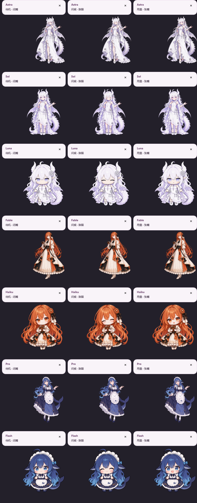

# Codex Companion

Windows x64 原生透明角色伴侣，配套一个本地 Codex 技能插件。C# / WPF 实现，不使用 Electron、WebView、浏览器或 JavaScript 运行时。

当前版本 **0.5.0**，提供七位角色：**Astra、Sol、Luna、Fable、Haiku、Pro、Flash**。每位均有待机闭嘴、问候眯眼、用量张嘴三张完整形态，配合轻量过渡和点击回弹；气泡关闭后恢复待机。奇数次左键显示五小时／周额度缓存和重置时间，偶数次显示本地台词。右键可切换角色、语言、大小、主题、额度联网方式、页面持续时间等设置。长按至少350毫秒后拖动才调整位置，不计为点击。简中、英文、日文共630条台词，图片、动画和问候均本地运行。

这是第三方 Windows 桌面伴侣，不是 OpenAI 官方插件。源码使用 [MIT](LICENSE)，角色图片与图标的许可范围见 [素材说明](ASSETS-NOTICE.md)。

## 运行

从 [Releases](https://github.com/qysnb/codex-companion/releases/latest) 下载运行包，完整解压后启动：

| 文件 | 适用情况 |
| --- | --- |
| `codex-companion-win-x64.zip` | 推荐；自带 .NET 8 Desktop Runtime，无需开发 SDK |
| `codex-companion-lite-win-x64.zip` | 体积较小；需要安装 .NET 8 Desktop Runtime x64 |
| `SHA256SUMS.txt` | 运行包校验值 |

自包含包双击 `marketplace/plugins/codex-companion/bin/CodexCompanion.exe`，Lite包对应目录为 `marketplace-lite`。保留 EXE 旁的 DLL、运行时和 assets 文件夹。GitHub 自动生成的 Source code ZIP 是源码，不是可直接运行的版本。

读取额度需要本机已安装 Codex 桌面端，并使用自己的 ChatGPT 登录。Codex 桌面窗口处于前台时角色出现并跟随窗口；切到其他软件、最小化或关闭Codex时自动隐藏。程序不占任务栏，从右键菜单退出。默认只显示本地内存缓存，不在启动或普通点击时联网；首次没有缓存时，右键选择“联网刷新额度”取得真实数据。

大小可选小杯180、中杯240、大杯320、超大杯420逻辑像素。原有三档的设置ID及数值保留，默认仍为Luna／中杯。屏幕空间不足时自动适配实际显示尺寸，保存的档位不变；气泡在上下放不下时可放在角色侧边。

安装插件参阅 [INSTALL.md](docs/INSTALL.md)。构建参阅 [BUILD.md](docs/BUILD.md)，验证摘要参阅 [VERIFICATION-PUBLIC.md](docs/VERIFICATION-PUBLIC.md)。

## 额度联网方式

**默认“本地缓存（仅手动联网）”。** 从旧版本升级、配置中没有联网方式字段时，也采用本地模式，避免旧的短间隔设置自动恢复后台查询。

| 方式 | 行为 |
| --- | --- |
| 本地缓存 | 启动、普通点击、隐藏、失败重试和本地重置倒计时不联网；仅“联网刷新额度”或 CLI `refresh-quota` 明确联网 |
| 按需联网 | 点击额度页时才可能读取；两次尝试至少间隔 `max(900 秒, 自动刷新间隔)`，失败也计入限频，不后台轮询 |
| 自动联网 | 用户明确选择后才预取、周期刷新、失败重试及重置点读取；隐藏角色仍会刷新，可能消耗较多流量 |

新设置的自动刷新间隔默认 **900 秒**；原用户的间隔值保留。菜单可选预设或自定义 5–3600 秒，调整间隔不会自动启用自动联网。任一模式都可明确手动刷新，并发请求会合并；切到本地模式会取消尚未转为明确手动请求的在途自动读取。

缓存仅保存在内存，退出后清空。气泡保留真实读取时间，旧快照不代表当前实时用量；联网时仍先确认账户身份，身份未知或换账户不复用旧账户缓存。本地倒计时不把额度推算为100%。

## 低占用设计

- 单个 WPF 进程、工作站 GC；没有常驻浏览器、HTTP 服务或数据库。
- 对齐在素材准备阶段完成。运行时只解码当前角色一张预对齐精灵图，三个切片共享同一图像源；按显示高度及 DPI 解码，最高 960 像素，不分析轮廓。点击不重新解码图片，命中检测仅保存单字节透明度。
- 表情过渡和整体戳击共用一个约30帧/秒的短时计时器，动作完成后停止。每次只绘制最多两层完整人物，快速打断时只保留一张当前画面快照，结束即释放引用。窗口跟随每秒4次，隐藏时每秒1次。窗口位置未变化时不重复调用定位API，进程路径匹配缓存5秒。
- 隐藏45秒后释放角色图片。气泡使用独立的轻量Popup，每次按当前文字重算内容高度及原生窗口大小，自动关闭后也不保留额度气泡的旧高度；默认贴在角色上方约6DIP处，工作区空间不足时选择下方或侧边。动画及气泡尺寸不会推动角色或更改拖动偏移。
- 优先使用本机App Server代理；不可用时使用自己的临时stdio子进程。该私有进程关闭插件、远程插件、模型发现、宿主技能发现、MCP与analytics等无关初始化，不修改桌面Codex的全局配置。
- 开发阶段当前CLI 0.166系列的一次手动读取代理样本约 **0.595 MB**。这是单次观测，不是每轮固定值或长期流量保证。临时连接隐藏时在读取完成后释放，可见时空闲约10秒释放，不以长期保活换取查询速度。
- 默认不开机启动，无声音。本地台词不消耗模型额度。额度重置提醒默认开启：同一已验证账户的真实读取从实际0%变为100%时，显示一次8秒无焦点提醒，可单独关闭；两个窗口同时恢复合并提醒。本地模式需要后续手动读取，按需模式也不保证在重置时刻即时提醒，不会根据本地倒计时假造恢复值。

自包含包的磁盘大小包含微软运行时，不能等同于常驻内存。`--command get-status` 返回工作集、私有内存和已解码帧数，便于在自己的机器上测量。

`memory.retainedArtBytes` 是当前三帧及透明度数组的像素数据预算，快速切换时包含至多一张临时快照，不代表整个WPF进程内存。中号240DIP、125%缩放时三帧预算：Astra约0.94MiB，Sol／Luna约1.29MiB。隐藏45秒后移除图片引用，实际内存回收时机由CLR和系统决定。

## 数据与边界

限额来自官方App Server的 `account/rateLimits/read`，以 `100 − usedPercent` 计算剩余百分比，并按窗口分钟数识别五小时／一周。不创建对话或推理任务，不估算消息数或token数。断网／超时显示未知或保留旧读取时间，不推算额度恢复。日期使用系统本地时区。缓存显示不等待网络；首次取得新数据仍受服务响应影响，不能承诺在150毫秒内完成真实网络读取。

账户和额度只读请求最多等待30秒，初始化握手最多10秒，响应提前到达即完成；网络读取不阻塞界面，退出会取消。仅自动模式按5／15／60秒退避重试，本地和按需模式不后台重试。程序不会为重试额外增加常驻进程。

不复制登录令牌，不修改 Codex 安装文件，不注入其他进程，不安装服务或网络监听。程序权限、设置及安全边界见 [SECURITY.md](docs/SECURITY.md)。运行包不包含 PowerShell 启动或测试脚本。

七套运行时精灵图位于 `assets/characters`。源码和图片分别说明许可，详见 [ASSETS-NOTICE.md](ASSETS-NOTICE.md)。

0.4.4 将额度气泡改为两组文字＋4DIP细条：限额名称、重置时刻、距重置时长、剩余百分比。额度气泡不再显示角色名，底部保留读取时间；闲聊仍显示角色名。右键角色 → 主题，可分别修改额度文字和细条颜色，提供五组预设、十六进制自定义和即时预览，保存后持久生效。

右键角色 → 页面持续时间，提供1s、3s、5s、10s、永久、自定义（1–86400秒）。默认额度和问候均10秒，保存后重启保留。仅气泡本身悬停、菜单和设置窗口打开期间暂停，鼠标停在角色上不暂停。点×始终可关闭。
