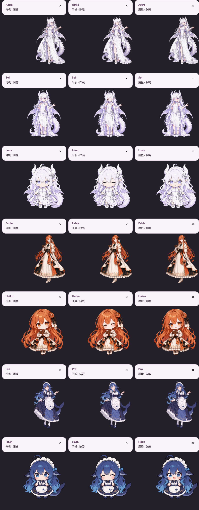

# Codex Companion

Windows x64 原生透明角色伴侣，配套一个本地 Codex 技能插件。C# / WPF 实现，不使用 Electron、WebView、浏览器或 JavaScript 运行时。

当前版本 **0.4.4**，提供七位角色：**Astra、Sol、Luna、Fable、Haiku、Pro、Flash**。每位角色均有三张完整形态：待机闭嘴、问候眯眼、用量张嘴；气泡关闭后恢复待机。完整人物先对齐头部中心与脚底，再以约140毫秒过渡，减少动画模式约70毫秒。左键点击时面部与身体一起短暂压缩回弹，约420毫秒后恢复原状，减少动画模式约180毫秒。连续点击从当前画面及变形继续。奇数次左键显示真实五小时／周限额和重置时间，偶数次显示本地台词。右键切换形象、语言、大小、主题、减少动画、刷新间隔、恢复位置、开机启动和退出。长按至少350毫秒后拖动才调整位置，不计为点击。简中、英文、日文共630条本地台词。

这是第三方 Windows 桌面伴侣，不是 OpenAI 官方插件。源码使用 [MIT](LICENSE)，角色图片与图标的许可范围见 [素材说明](ASSETS-NOTICE.md)。

## 运行

从 [Releases](https://github.com/qysnb/codex-companion/releases/latest) 下载运行包，完整解压后启动：

| 文件 | 适用情况 |
| --- | --- |
| `codex-companion-win-x64.zip` | 推荐；自带 .NET 8 Desktop Runtime，无需开发 SDK |
| `codex-companion-lite-win-x64.zip` | 体积较小；需要安装 .NET 8 Desktop Runtime x64 |
| `SHA256SUMS.txt` | 运行包校验值 |

自包含包双击 `marketplace/plugins/codex-companion/bin/CodexCompanion.exe`，Lite包对应目录为 `marketplace-lite`。保留 EXE 旁的 DLL、运行时和 assets 文件夹。GitHub 自动生成的 Source code ZIP 是源码，不是可直接运行的版本。

需要本机已安装 Codex 桌面端，并使用自己的 ChatGPT 登录读取额度。Codex 桌面窗口处于前台时角色出现并跟随窗口；切到其他软件、最小化或关闭Codex时自动隐藏。程序不占任务栏；从角色的右键菜单退出。启动即异步预取限额，点击直接显示内存中的真实快照和读取时间，并在后台更新。

大小可选小杯180、中杯240、大杯320、超大杯420逻辑像素。原有三档的设置ID及数值保留，默认仍为Luna／中杯。屏幕空间不足时自动适配实际显示尺寸，保存的档位不变；气泡在上下放不下时可放在角色侧边。

安装插件参阅 [INSTALL.md](docs/INSTALL.md)。构建参阅 [BUILD.md](docs/BUILD.md)，验证摘要参阅 [VERIFICATION-PUBLIC.md](docs/VERIFICATION-PUBLIC.md)。

## 低占用设计

- 单个 WPF 进程、工作站 GC；没有常驻浏览器、HTTP 服务或数据库。
- 对齐在素材准备阶段完成。运行时只解码当前角色一张预对齐精灵图，三个切片共享同一图像源；按显示高度及 DPI 解码，最高 960 像素，不分析轮廓。点击不重新解码图片，命中检测仅保存单字节透明度。
- 表情过渡和整体戳击共用一个约30帧/秒的短时计时器，动作完成后停止。每次只绘制最多两层完整人物，快速打断时只保留一张当前画面快照，结束即释放引用。窗口跟随每秒4次，隐藏时每秒1次。窗口位置未变化时不重复调用定位API，进程路径匹配缓存5秒。
- 隐藏45秒后释放角色图片。气泡使用独立的轻量Popup，每次按当前文字重算内容高度及原生窗口大小，自动关闭后也不保留额度气泡的旧高度；默认贴在角色上方约6DIP处，工作区空间不足时选择下方或侧边。动画及气泡尺寸不会推动角色或更改拖动偏移。
- 启动异步预取，默认每30秒在后台刷新，右键可设15/30/60/120/300秒或自定义5–3600秒。每个已知重置时间到达后另外触发读取；同时到期的请求合并。隐藏状态仍维护缓存，但完成读取后立即释放临时连接；可见时空闲约10秒释放。
- 较短刷新间隔会增加后台请求和资源占用。可见状态的5秒间隔可能持续复用连接，避免反复冷启动。默认30秒不会为每次点击重新启动服务。
- 默认不开机启动，无声音。本地台词不消耗模型额度。额度重置提醒默认开启：同一已验证账户的五小时或周剩余额度从实际 0% 变为 100% 时，显示一次 8 秒无焦点弹窗，可在右键“额度重置提醒”关闭。两个窗口同时重置合并提醒；首次读取为 100%、未知值、旧缓存和账户切换不触发。不新增查询、常驻进程或后台计时器。

自包含包的磁盘大小包含微软运行时，不能等同于常驻内存。`--command get-status` 返回工作集、私有内存和已解码帧数，便于在自己的机器上测量。

`memory.retainedArtBytes` 是当前三帧及透明度数组的像素数据预算，快速切换时包含至多一张临时快照，不代表整个WPF进程内存。中号240DIP、125%缩放时三帧预算：Astra约0.94MiB，Sol／Luna约1.29MiB。隐藏45秒后移除图片引用，实际内存回收时机由CLR和系统决定。

## 数据与边界

限额来自官方App Server的 `account/rateLimits/read`，使用百分比换算为剩余百分比，并按窗口分钟数识别五小时／一周。共享代理不可用时使用临时stdio子进程，不创建对话或推理任务。断网／超时会明确显示未知或过期，不推算额度恢复。日期使用系统本地时区。150毫秒目标针对已预取缓存的显示路径；首次没有任何缓存时，真实网络同步仍受服务响应影响，不能承诺在150毫秒内取得全新数据。

0.4.2修复两层固定10秒截止时间会提前取消正常慢响应的问题：账户和额度只读请求统一最多等待30秒，初始化握手保持10秒；响应提前到达即完成。网络读取不阻塞界面，退出立即取消。后台空闲连接的释放策略不变，不增加常驻进程。详见 [更新说明](docs/UPDATE-0.4.2.md)。

不复制登录令牌，不修改 Codex 安装文件，不注入其他进程，不安装服务或网络监听。程序权限、设置及安全边界见 [SECURITY.md](docs/SECURITY.md)。运行包不包含 PowerShell 启动或测试脚本。

七套运行时精灵图位于 `assets/characters`。源码和图片分别说明许可，详见 [ASSETS-NOTICE.md](ASSETS-NOTICE.md)。

0.4.4 将额度气泡改为两组文字＋4DIP细条：限额名称、重置时刻、距重置时长、剩余百分比。额度气泡不再显示角色名，底部保留读取时间；闲聊仍显示角色名。右键角色 → 主题，可分别修改额度文字和细条颜色，提供五组预设、十六进制自定义和即时预览，保存后持久生效。
